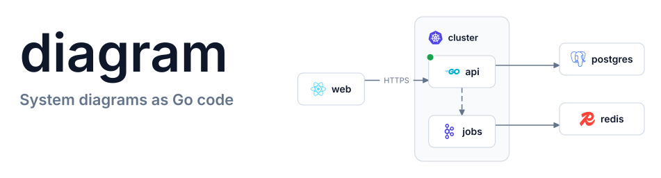
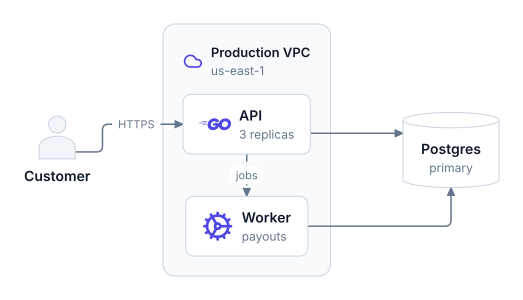

# diagram

<picture>
  <source media="(prefers-color-scheme: dark)" srcset="docs/header-dark.svg">
  
</picture>

diagram draws system diagrams from Go code. You put nodes in rows, columns
and grids, connect them, and it routes the edges and writes SVG, PNG, an
interactive HTML page or an editable draw.io file.

It's written in Go with no dependencies outside `golang.org/x/image`, so
there's no Graphviz or browser to install.

```
go get github.com/grindlemire/diagram
```

## Example

```go
d := diagram.New("Checkout")

user := d.Node("Customer", diagram.Person)
vpc := d.Column("Production VPC", diagram.Icon(generic.Cloud), diagram.Desc("us-east-1"))
api := vpc.Node("API", diagram.Icon(brands.Go), diagram.IconLeft, diagram.Desc("3 replicas"))
worker := vpc.Node("Worker", diagram.Icon(generic.Cog), diagram.IconLeft, diagram.Desc("payouts"))
db := d.Node("Postgres", diagram.Cylinder, diagram.Desc("primary"))

d.Connect(user, api, diagram.Label("HTTPS"))
d.Connect(api, worker, diagram.Dashed, diagram.Label("jobs"))
d.Connect(api, db)
d.Connect(worker, db)

err := d.WriteFile("checkout.svg") // or .png, .html, .drawio
```

<picture>
  <source media="(prefers-color-scheme: dark)" srcset="docs/quickstart-dark.svg">
  
</picture>

## Layout

You decide where things go by what you add them to. The diagram itself lays
its children out left to right.

| Container | Lays out children | Add a node |
|---|---|---|
| `Row` | left to right | `row.Node("API")` |
| `Column` | top to bottom | `col.Node("API")` |
| `Grid` | in cells | `grid.Node("API", row, col)` |
| `Canvas` | at x, y positions | `canvas.Node("API", x, y)` |

Containers nest. Give one a label and it draws a box around its children;
leave the label empty and it only arranges them. `Gap`, `Padding`, the
`Align*` and `Justify*` options and `Uniform` (same-size children) adjust
the spacing.

Nodes take a description (`Desc`), an icon (`Icon`) and a shape: `Box`,
`Rect`, `Pill`, `Circle`, `Cylinder`, `Queue`, `Document`, `Person`, `Note`
or `Text`. `Badge("beta")` and `Status(diagram.Green)` mark them.

## Edges

`d.Connect(from, to, opts...)` connects two nodes or containers. Edges are
drawn with right angles and routed around everything in the way. `Path` and
`Fan` add several at once:

```go
d.Path(web, api, db)     // web → api → db
d.Fan(lb, w1, w2, w3)    // lb → each worker
```

Options include `Label`, `Dashed`, `Dotted`, arrowheads (`ArrowBoth`,
`NoArrow`, `Head`, `Tail`), and `Exit`, `Enter` and `Via` to pin where an edge
leaves, arrives and passes.

Gaps grow to fit the edges that run through them. Pass
`diagram.ExactSpacing` to `New` to keep your gaps exactly as written.

## Styles and themes

Styles are values you can bundle and reuse:

```go
critical := diagram.Named("critical path", diagram.Stroke(diagram.Red), diagram.StrokeWidth(2))
d.Connect(api, db, critical)
d.Legend("Legend") // lists the named styles the diagram uses
```

`Fill`, `Stroke`, `TextColor`, `StrokeWidth`, `Radius`, `FontSize` and
`Bold` work on nodes, groups and edges. Colours are theme tokens
(`diagram.Accent`, `diagram.Red`) or literals (`diagram.Hex("#ff6600")`).

The `themes` package has `Light` (the default), `Dark`, `Blueprint` and
`Auto(light, dark)`, which follows the viewer's dark-mode setting.

## Icons

Three icon sets ship as separate packages, so you only compile in what you
use: `icons/generic` (servers, databases, queues, users), `icons/network`,
and `icons/brands` (Postgres, Kafka, Kubernetes and others). Your own SVG or
PNG files work too:

```go
logo, err := icons.Open("logo.svg")
d.Node("Our service", diagram.Icon(logo))
```

## Output

`WriteFile` picks the format from the extension. `RenderSVG`, `RenderPNG`,
`RenderHTML` and `RenderDrawio` write to an `io.Writer`.

- **SVG** embeds the parts of the font it uses, so it looks the same
  everywhere.
- **PNG** is drawn in Go and matches the SVG.
- **HTML** is a single file you can pan, zoom and search. Hovering a node
  highlights its connections. Click one node and Shift-click another to
  trace the path between them.
- **draw.io** files stay editable: boxes are real draw.io shapes and edges
  stay attached when you move them.

To put the interactive view inside your own page, use `diagram.Embed(d)` in a
templ template or `d.HTMLFragment()` with `html/template`:

```go
@diagram.Embed(docs.Checkout(), diagram.Height("480px"))
```

## Errors

Builder methods don't return errors. Mistakes are collected with the file
and line that made them, and `Validate` or any render call returns them all:

```
checkout.go:9: node "Worker 2": cell (0,1) already occupied by node "Worker 1" (checkout.go:8)
```

## Command line

```
go install github.com/grindlemire/diagram/cmd/diagram@latest
```

Every exported `func() *diagram.Diagram` in a package is a diagram the
command can draw. `diagram render` writes them to files, and `diagram watch`
serves them as pages that reload when you save.

## Testing

`diagramtest.Golden(t, d)` compares a diagram with a saved copy in
`testdata/`. Run `go test ./... -diagram.update` to save new copies.

## Licence

MIT. The bundled Inter font, Lucide icons and Simple Icons logos keep their
own licences, which sit next to them in the repo. Brand logos are trademarks
of their owners.
